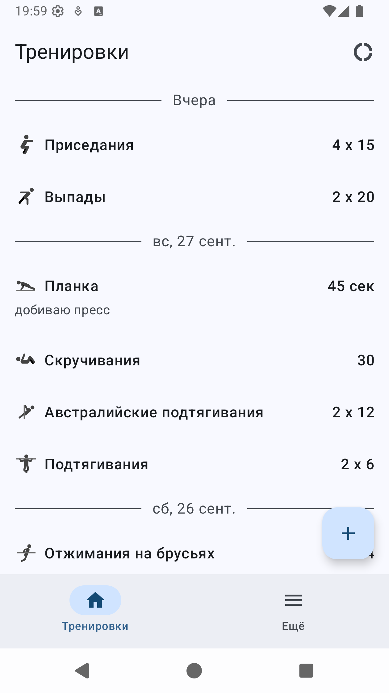
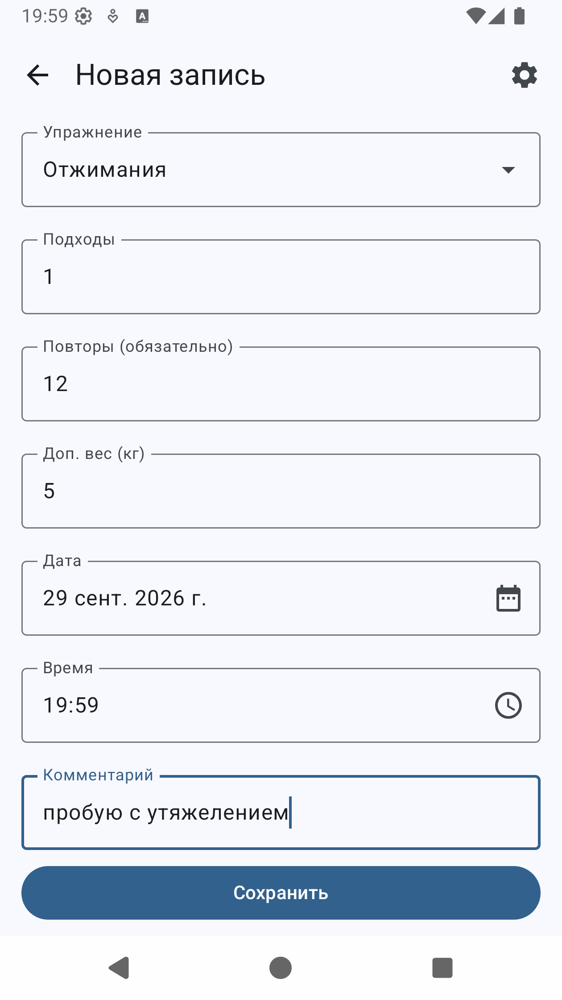
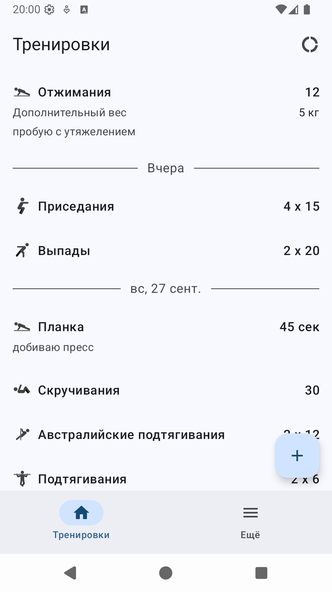
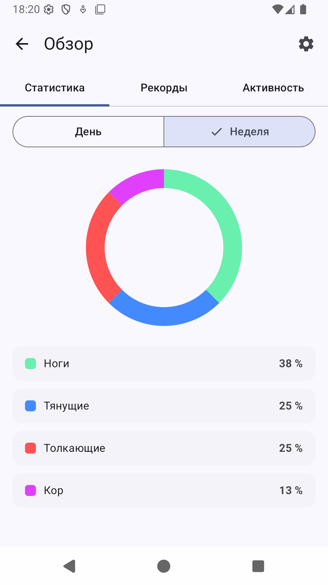
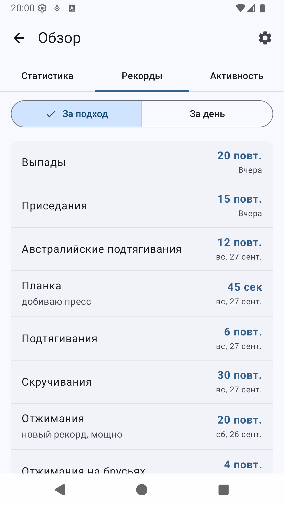
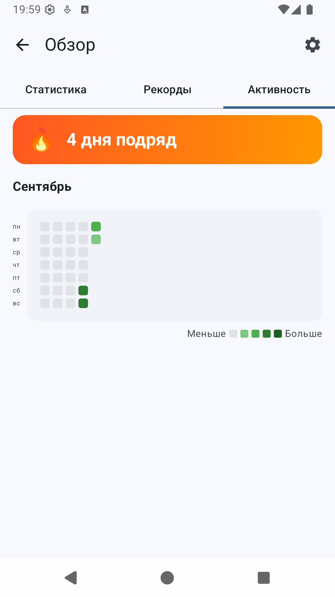

# Мои тренировки

<!-- BEGIN_VERSIONS -->
[](https://kotlinlang.org/)
[](https://developer.android.com/)
[](https://developer.android.com/)
[](https://gradle.org/)
[](https://developer.android.com/tools/releases/gradle-plugin)
<!-- END_VERSIONS -->

- Идея приложения в том, чтобы записывать свои тренировки — упражнение, подходы, повторения, доп.вес, длительность и комментарий, — а потом наглядно отслеживать прогресс: статистику, рекорды и активность
- Приложение работает полностью офлайн — все данные хранятся локально на устройстве
- Приложение автоматически адаптирует размер шрифтов к системным настройкам

## Что можно делать в приложении

1. Создавать/изменять/удалять записи о тренировках: упражнение, подходы, повторения, вес, длительность, комментарий
2. Управлять списком упражнений: стандартные и свои, с категориями и иконками, архивировать неиспользуемые, менять/удалять свои упражнения
3. Смотреть статистику за неделю/месяц/год: рекорды за подход, серии тренировок, распределение по категориям
4. Отслеживать активность на тепловой карте

## Начало работы

1. Клонируйте репозиторий
2. В терминале перейдите в папку с проектом
3. Все команды доступны через `Makefile`:

- Ознакомиться с доступными командами можно, выполнив команду:

```shell
make help
```

## Скриншоты

| Список тренировок | Создание записи | Новая запись | Статистика за неделю | Рекорды | Активность |
| --- | --- | --- | --- | --- | --- |
|  |  |  |  |  |  |

### Релизный процесс

Проект собирается в двух `productFlavors` — `rustore` (RuStore, основной канал) и `github` (GitHub Release, альтернативный). Команды `make rustore` (RuStore — все шаги одной командой, включая загрузку в RuStore по API) или `make rustore-draft` → `make rustore-commit VID=<vid>` (черновик + ручная отправка на модерацию); `make apk FLAVOR=github` для APK.

Инструкция по созданию сборки и управлению версиями: [deployment.md](docs/deployment.md)
